# O que planejamos e o que aprendemos

Diário de decisões do chassi, na ordem em que aconteceram. Cada seção conta o que íamos fazer, o que deu errado ou mudou, o que isso nos ensinou e o que ficou no projeto por causa disso. As medidas citadas são as da [`specs/modulos.json`](../specs/modulos.json) de hoje, e as figuras saem do mesmo código que gera os cortes (`figuras.py` e `vista3d.py`), então mudam junto com a spec.

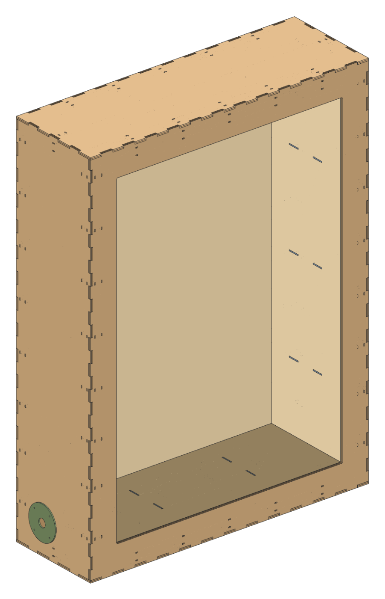

## 1. Três lâminas, parafuso M3 e 1500 mm de altura

**Íamos fazer** dois módulos altos, de 1500 mm: o biométrico com 250 x 1500 x 250 e o armário com 1260 x 1500 x 350. Cada face seria um sanduíche de três lâminas de MDF de 3 mm (9 mm no total), presas por uma malha de parafusos M3. Na lâmina do meio, furo passante. Nas de fora, furo e bolso sextavado para a porca, alternando por fileira.

**Mas** o desenho ficou cheio de furo e o conjunto não passava firmeza. Cada painel tinha dezenas de pontos de parafuso, e cada ponto era um furo e uma porca a mais para alinhar na montagem. E, mais sério, a máquina do laboratório (eCNC L-1210) tem mesa de 1150 x 1000 mm: nenhum painel de 1500 entrava nela.

**Isso nos mostrou** que quem manda no tamanho do móvel é a mesa, e não o desenho. E que prender lâmina com parafuso custa mais montagem do que a rigidez que devolve.

**Então** o painel passou para duas lâminas (6 mm), a malha M3 saiu e quem amarra faces e lâminas agora é abraçadeira de nylon de 4,8 mm em rasgos de 6,5 x 2,5 mm, o **enforca-gato**. A altura caiu para 1000 mm nos dois módulos, e cada arquivo de corte sai em cargas de no máximo 1000 x 1000, deitando os painéis retangulares. Os 150 mm que sobram na mesa ficam de margem.

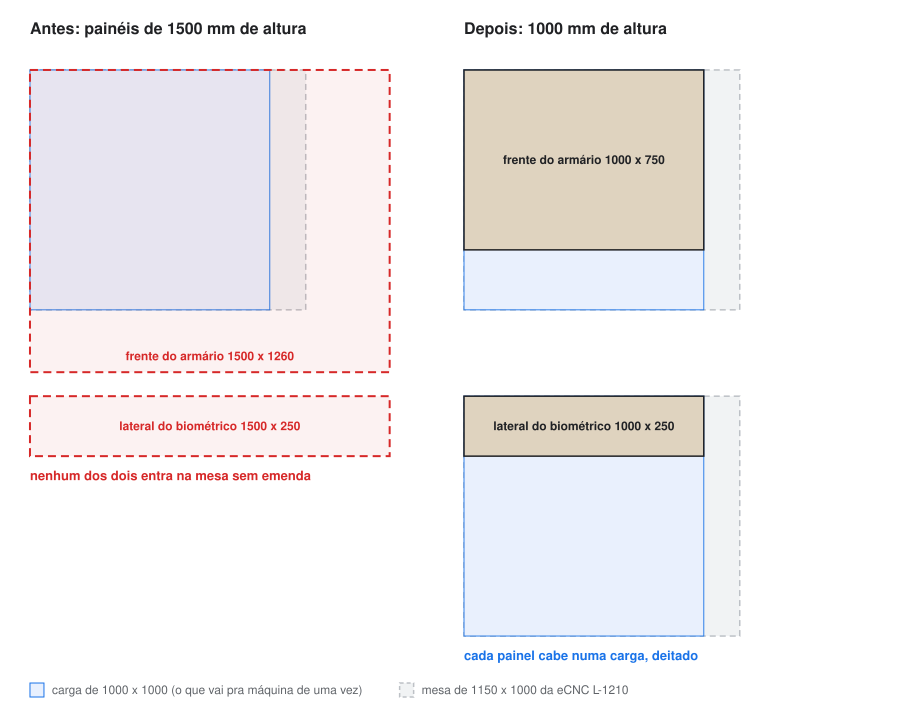

## 2. Dedos que não fechavam o canto

**Íamos fazer** a junta de dedos à mão, alternando a fase do perfil em cada aresta.

**Mas** os cantos não fecharam. Numa caixa de seis faces, cada uma das 24 arestas tem que saber quem é dono do canto, e alternar só a fase deixa dois dedos disputando o mesmo cubo de 6 x 6 x 6.

**Isso nos mostrou** que junta de dedos em caixa fechada é problema resolvido e que não vale reinventar.

**Então** os contornos das faces saem da matriz completa do [TabbedBoxMaker](https://github.com/paulh-rnd/TabbedBoxMaker), com dimensões externas e número ímpar de divisões. A simulação 3D confirma hoje, por amostragem de 0,5 mm em todos os cantos do armário, que nenhum dedo invade outro.

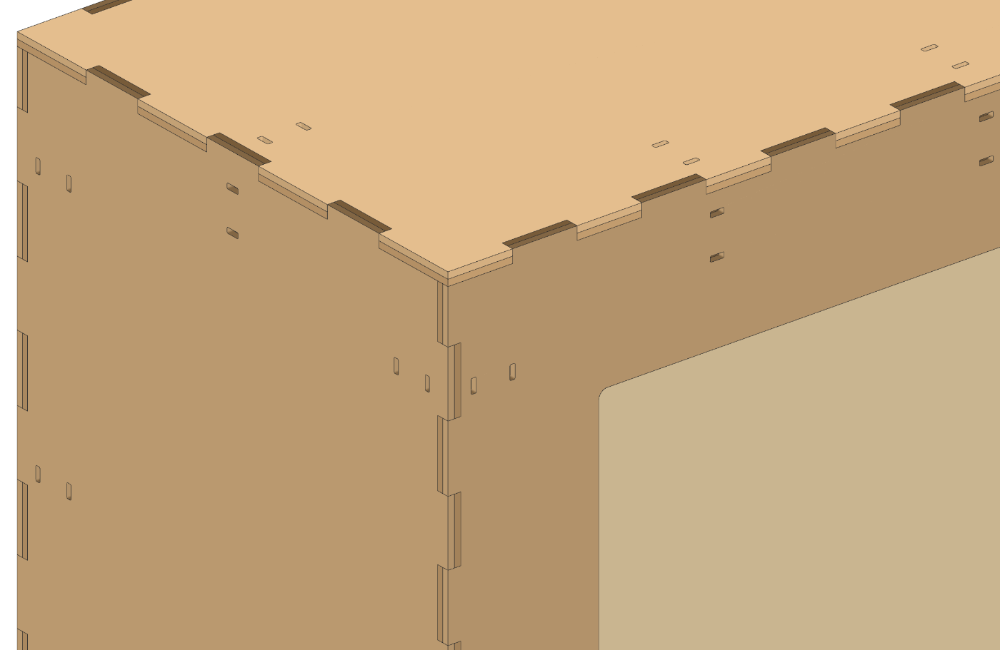

## 3. Uma página por módulo e 34% de aproveitamento

**Íamos fazer** os cortes em páginas separadas por módulo, cada peça na sua faixa.

**Mas** o biométrico ocupava 34,3% da chapa. As tampas dos passa-fios, por exemplo, iam para uma faixa própria enquanto a janela da frente jogava fora um retângulo de 180 x 500.

**Isso nos mostrou** que o material sobrando dentro das janelas já está pago.

**Então** o gerador ganhou nesting próprio: uma prancha só, first-fit com seis ordenações, rotação de 90 graus e reaproveitamento dos vazios que as próprias janelas deixam. O alvo do otimizador é área. O biométrico foi para 78,6% sem mexer em peça nenhuma. Quando o projeto precisa mandar, a peça declara onde mora (`alojar_em`): as tampas `BTR` e `BTF` saem de dentro da janela da `B6E`, na carga 3.

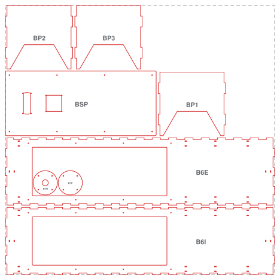

## 4. O DXF que a máquina recusou e a peça que virou círculo

**Íamos fazer** o DXF de qualquer jeito válido. Depois que o técnico do laboratório mandou o arquivo-modelo dele, a ideia passou a ser herdar o perfil relendo o modelo e reescrevendo tudo.

**Mas** dois erros custaram viagem até a máquina. O primeiro: para economizar entidade, o escritor tentava reconhecer polígono que era círculo pela distância média ao centro, com 1% de folga. Um retângulo de canto arredondado curto só tem pontos nos cantos, todos à meia diagonal, e passou no teste. O sub-painel `BSP`, de 240 x 560, foi para o arquivo como uma circunferência de raio ~305 mm. O segundo: ao reescrever o modelo do técnico, o tratamento de texto comeu o preenchimento dos inteiros no cabeçalho, e o AutoCAD descartou o desenho como "Entrada DXF inválida ou incompleta".

**Isso nos mostrou** duas coisas. Heurística que "adivinha" geometria tem que ser testada justamente nas formas que quase passam. E arquivo de terceiro não se reserializa: se copia.

**Então** o DXF sai no perfil exato do técnico (AutoCAD 2018, AC1032, milímetro, camada `CORTE` em vermelho, `LWPOLYLINE` e `CIRCLE`) por cópia de bytes: cabeçalho e rodapé vêm crus do modelo, só a seção de entidades é gerada. Depois veio um terceiro detalhe, o `$HANDSEED` herdado abaixo do maior handle, que travava a abertura no AutoCAD; corrigido com teste. Furos e recortes vão antes do contorno de cada peça, para a peça não se soltar antes do furo.

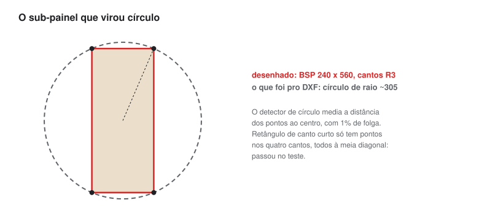

## 5. Conferir peça girada

**Íamos** conferir as pranchas olhando o PDF e comparando com a montagem.

**Mas** o nesting deita os painéis 90 graus. Um par de rasgos que é vertical na montagem aparece horizontal na prancha. Foram cinco rodadas de "está errado" num desenho que estava certo.

**Isso nos mostrou** que a regra de leitura da prancha tem que estar escrita, e não na cabeça de quem gerou.

**Então** o README avisa que peça retangular fica sempre deitada e o rasgo vertical aparece horizontal. Para a casca do armário, existe uma prancha só com as lâminas externas (`modulo-armario-externas`), para conferir sem as internas por cima.

## 6. O LCD do datasheet não é o LCD na mão

**Íamos fazer** o vão do LCD 1602A pelo datasheet. Três fabricantes (Tinsharp, EONE e HJ1602A) concordavam: furos em 75 x 31 e moldura de cerca de 71 x 24 a 27 mm.

**Mas** a foto da peça do grupo, em resolução cheia, mostrou a moldura passando cerca de 1 mm da linha dos furos em cada ponta, uns 76,5 x 25, e uma lingueta branca do backlight saindo numa ponta.

**Isso nos mostrou** que datasheet genérico de 1602 não descreve o clone que está na bancada. A furação bate em todas as fontes, a moldura não.

**Então** o vão é 78 x 26 com uma lingueta de 10 x 1 nas duas pontas, para servir com a placa montada de qualquer lado. Cada medida da spec leva o campo `fonte`, e [`componentes.md`](componentes.md) registra de onde veio cada uma. Medida que veio de foto está marcada como fraca e passa por corte de teste antes do corte oficial.

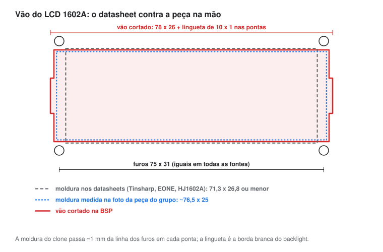

## 7. A ponte de 0,95 mm do teclado

**Íamos fazer** o vão do teclado 4x4 com o recorte de painel do fabricante (60 x 57, R4) e os quatro furos dos cantos.

**Mas** o próprio fabricante põe os furos colados no recorte. No MDF de 3 mm, sobram 0,95 mm entre cada furo e o vão. O piso do projeto é 1,5 mm (metade da espessura), e a checagem de fabricação reprovou a peça.

**Isso nos mostrou** que regra de fabricação precisa ter porta de exceção. Sem ela, quem quer passar desliga a regra inteira.

**Então** a `BSP` declara a exceção na spec (`ponte_aceita_mm` e o motivo por extenso), o gerador imprime `EXCECAO DFM BSP` toda vez que roda, e um teste garante que ponte fina só passa nessa peça. Se uma ponte trincar, o parafuso ainda aperta a base do teclado por fora do furo.

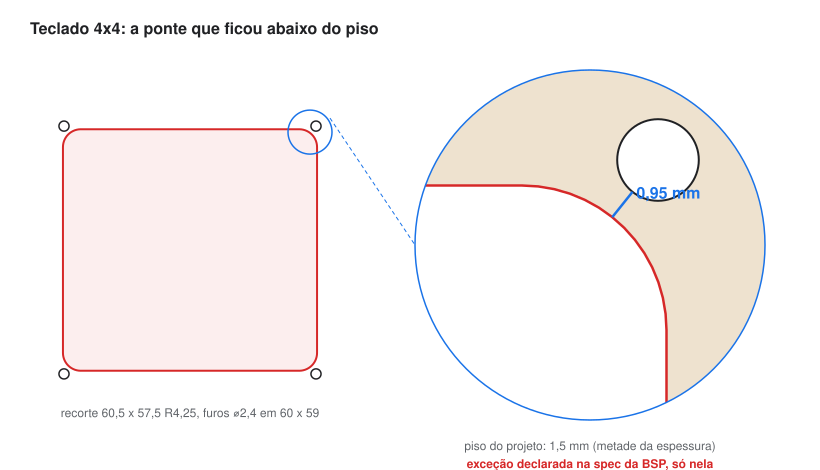

## 8. A peça que já tinha sido cortada

**Íamos** recortar a `BSP` inteira de novo, já com os vãos.

**Mas** ela tinha sido cortada no primeiro dia de máquina, antes de existir LCD e teclado no desenho.

**Isso nos mostrou** que o desenho anda mais rápido que o corte, e que peça física também é versão.

**Então** o gerador exporta só os vãos de uma peça, sem o contorno, com a origem no canto de baixo à esquerda (`--vaos BSP`). O PDF gêmeo sai em 1:1 e serve de gabarito: impresso em 100%, alinha os vãos na peça que já existe.

## 9. O armário que não cabia

**Íamos fazer** o armário com 1260 x 1500 x 350 e três portas em pílula deitadas, cada uma com a folha como peça própria.

**Mas** 18 das 19 cargas dele eram peça fora de medida. O armário só existia como prancha de conferência.

**Isso nos mostrou** o mesmo que o biométrico já tinha mostrado: o módulo nasce do tamanho da mesa.

**Então** o armário ficou com 750 x 1000 x 250, a mesma altura e profundidade do biométrico. Todas as 29 peças cabem, em 6 cargas. A porta saiu do escopo por agora, para fechar primeiro a parte de fora: a frente virou uma moldura de 70 mm em volta de um vão de 610 x 860.

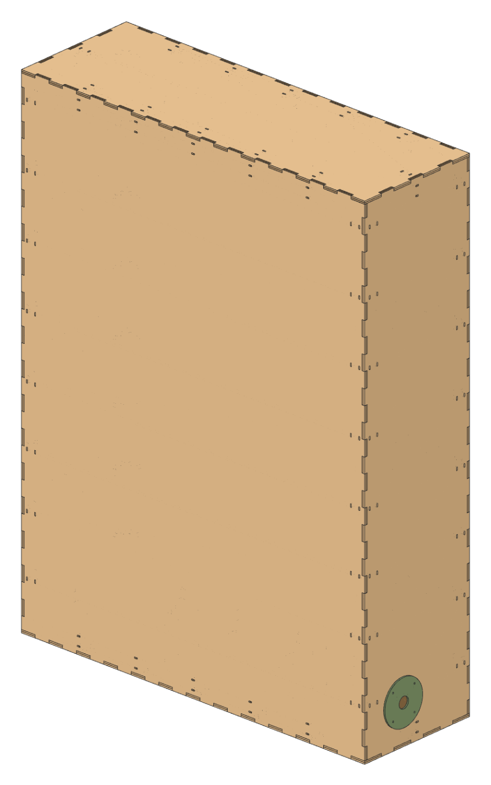

## 10. Nicho, folga de 61 mm e lateral lisa

**Íamos** deixar a casca vazia por dentro.

**Mas** os fios entram pelos passa-fios das laterais e precisam de caminho até a frente sem atravessar o espaço dos medicamentos.

**Isso nos mostrou** que a moldura de 70 mm já dava o espaço: 6 mm de casca, 3 mm de parede interna e 61 mm de corredor de fio entre os dois.

**Então** entrou o **nicho** (`AN1` a `AN5`), uma caixa de cinco faces em lâmina única, sem frente, que por dentro mede o vão da moldura. Dez **espaçadores** (`AE1` a `AE10`) seguram o nicho no lugar: três por lateral e dois no piso e no teto. As abas de um lado atravessam o nicho e as do outro entram só na lâmina interna da casca, então por fora a lateral continua lisa.

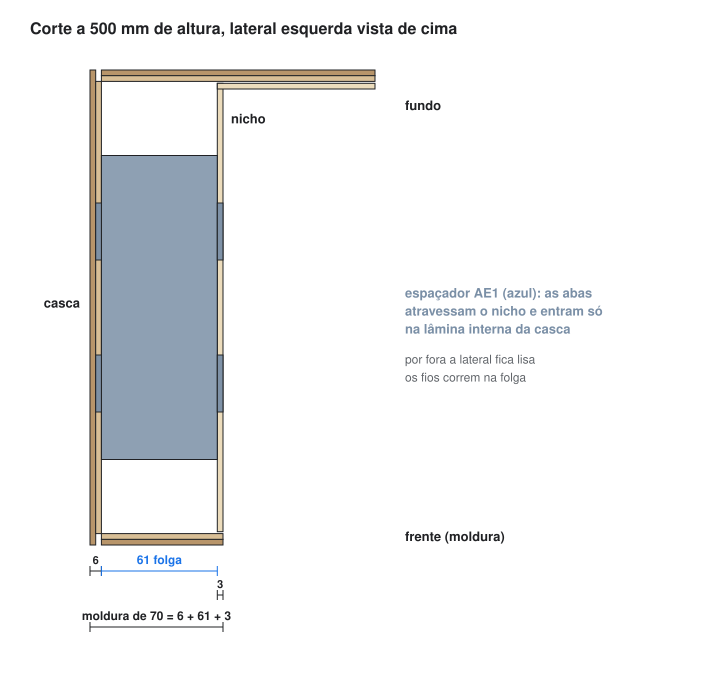

<table>
<tr>
<td width="50%">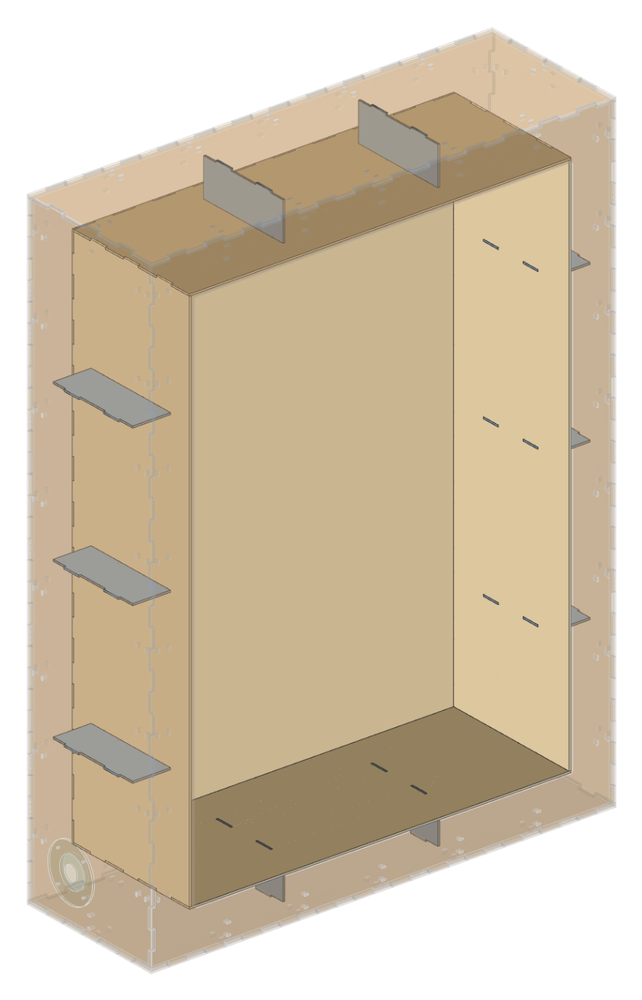 Casca transparente: o nicho e os dez espaçadores</td>
<td width="50%">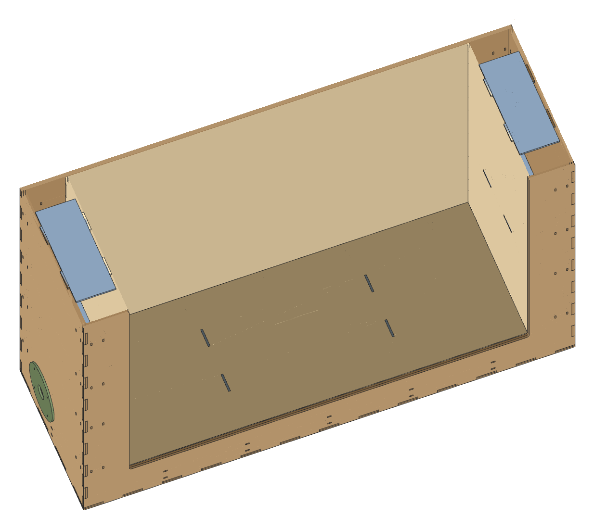 Corte a 500 mm: as abas nos rasgos dos dois lados</td>
</tr>
</table>

## 11. Montar antes de cortar

**Íamos** conferir o armário só pelas pranchas 2D, como o biométrico.

**Mas** com casca, nicho e espaçadores, a pergunta deixou de ser "a peça está certa?" e passou a ser "as peças fecham juntas?". Isso uma prancha plana não responde.

**Isso nos mostrou** que dava para montar o móvel no computador com as mesmas peças que vão para a máquina, sem redesenhar nada.

**Então** o `vista3d.py` extruda os 29 contornos do gerador, põe cada um no lugar e confere o encaixe antes de desenhar: se um dedo, uma aba ou uma tampa invade outra peça, ele para e não gera o PDF. A montagem fechou com zero sobreposição e devolveu duas perguntas que a prancha escondia. Em que lateral vai cada tampa? A simulação supõe a rosqueada à esquerda. E o nicho só encaixa nos rasgos centrado na profundidade, o que deixa 1 mm entre a boca dele e a moldura.

<table>
<tr>
<td width="50%">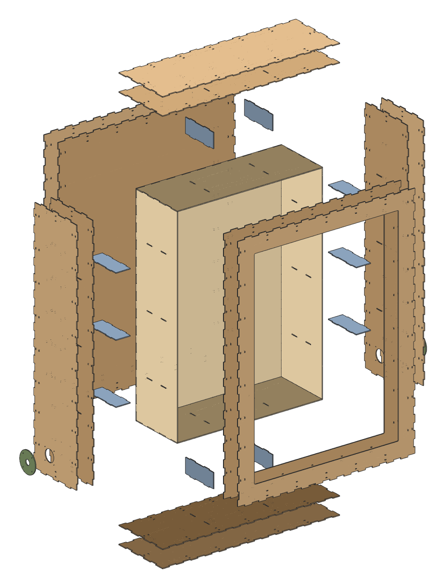 Explodida: cada face para fora, nicho no centro</td>
<td width="50%">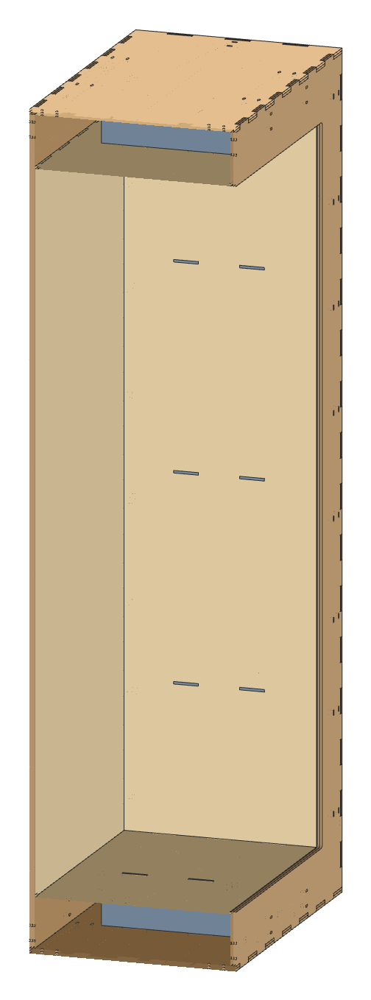 Corte vertical: espaçadores do piso e do teto</td>
</tr>
</table>

## 12. Repositório público

**Íamos** publicar o gerador como estava.

**Mas** o arquivo-modelo do técnico carregava para dentro de todo DXF gerado o usuário e o caminho de outro computador, além do nome de um projeto alheio. E os DWG salvos pelo AutoCAD gravam o usuário da máquina num conteúdo comprimido.

**Isso nos mostrou** que metadado viaja junto com o desenho e ninguém vê.

**Então** a cópia pública troca só esses valores no cabeçalho, por bytes, e foi auditada entidade por entidade contra os arquivos originais. DWG não entra no repositório.

## O que continua em aberto

* Kerf (0,18 mm) e espessura (3,00 mm) do MDF ainda são estimativa: falta o cupom de calibração.
* Armário: porta, visor, dobradiça, tranca, fixação do nicho na moldura, divisórias internas e a lateral de cada tampa.
* Interface do biométrico: corte de teste dos vãos do LCD e do teclado antes do corte oficial; sensor biométrico ainda sem vão.
